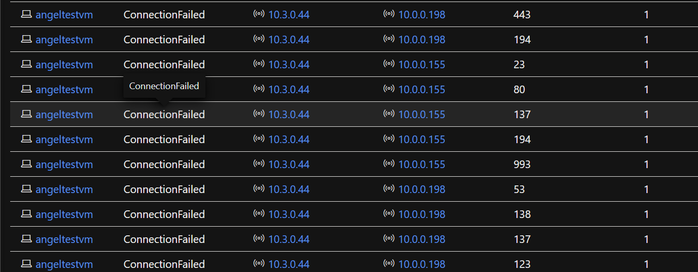
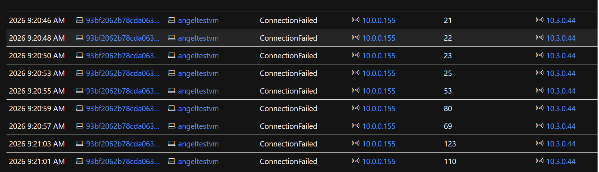
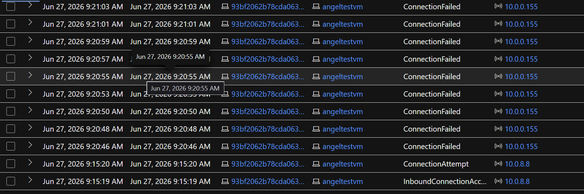
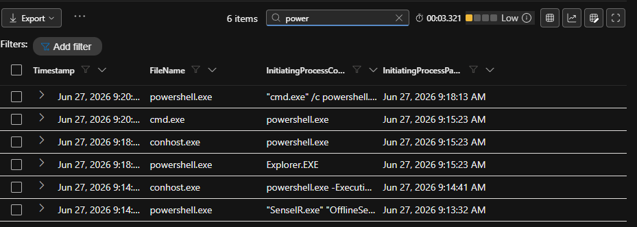
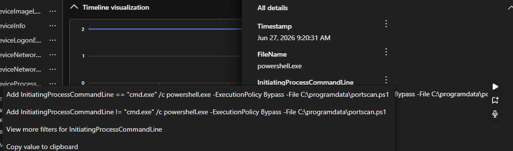
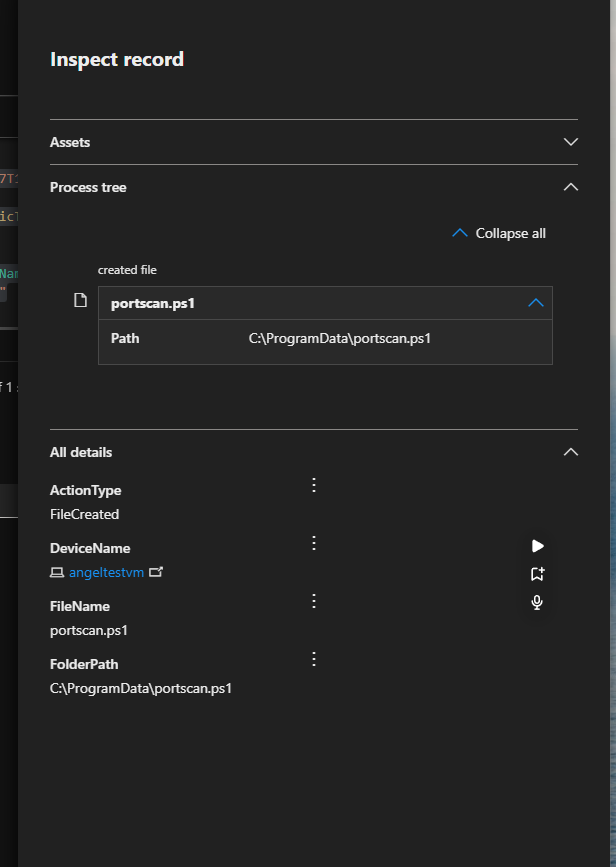
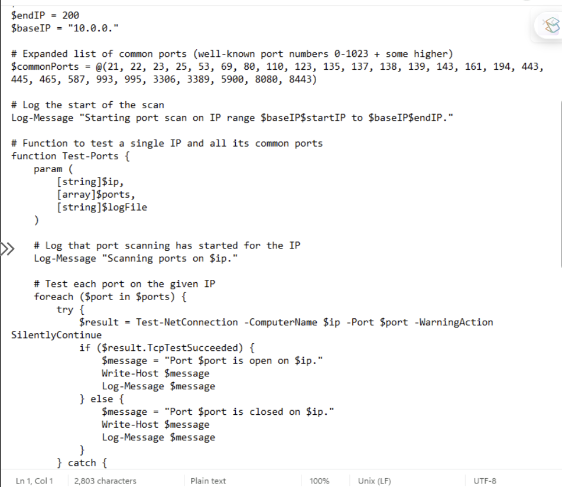
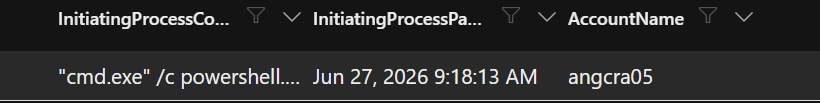

# Threat Hunt: Internal Port Scanning Activity via PowerShell

**Case ID:** TH-2026-0627-014
**Classification:** Internal Threat Hunt — Confirmed Malicious/Unauthorized Activity
**Environment:** Internal corporate network (10.0.0.0/16), monitored via Microsoft Defender for Endpoint
**Tools:** Microsoft Defender for Endpoint (MDE) · Kusto Query Language (KQL) · MITRE ATT&CK
**Status:** Closed — Remediated

---

## Table of Contents
- [Executive Summary](#executive-summary)
- [1. Hypothesis](#1-hypothesis)
- [2. Data Collection](#2-data-collection)
- [3. Analysis](#3-analysis)
- [4. Investigation](#4-investigation)
- [5. Response & Containment](#5-response--containment)
- [6. MITRE ATT&CK Mapping](#6-mitre-attck-mapping)
- [7. Root Cause](#7-root-cause)
- [8. Recommendations](#8-recommendations)
- [9. Lessons Learned](#9-lessons-learned)

---

## Executive Summary

The Server Operations team reported unexplained network performance degradation affecting several legacy devices on the internal 10.0.0.0/16 network. After ruling out external DDoS activity, the Security team initiated a proactive threat hunt to determine whether the slowdowns were caused by internal, unauthorized activity.

The investigation identified a workstation (`angeltestvm`, 10.3.0.44) conducting an internal port scan against neighboring hosts using a PowerShell script (`portscan.ps1`) staged in `C:\ProgramData\`. The device was isolated, scanned for malware, and rebuilt. No evidence of lateral movement, data exfiltration, or malware persistence was found beyond the reconnaissance activity itself.

All queries referenced below are in [`queries.kql`](./queries.kql).

---

## 1. Hypothesis

The environment permits unrestricted internal (east-west) traffic between hosts and does not restrict PowerShell execution. Given the reported symptom (network slowdowns on legacy devices, external DDoS ruled out), two working theories were formed:

- A host may be scanning the internal network (reconnaissance / lateral movement staging).
- A host may be performing large, unthrottled file transfers, consuming bandwidth and degrading performance for nearby devices.

**Working hypothesis:** *An internal host is generating abnormal connection volume — consistent with network scanning — against other hosts in the 10.0.0.0/16 range.*

---

## 2. Data Collection

Confirmed the following Defender for Endpoint tables had sufficient recent telemetry to support the hunt:

| Table | Purpose |
|---|---|
| `DeviceNetworkEvents` | Connection attempts, success/failure, source/destination IP and port |
| `DeviceProcessEvents` | Process execution, command lines, parent/child relationships |
| `DeviceFileEvents` | File creation, modification, and deletion events |

---

## 3. Analysis

### 3.1 Identifying anomalous connection volume

Searched for internal-to-internal failed connections, which are a strong indicator of port scanning — a scanner generates many failed connections against closed ports across a range of hosts/ports.

```kql
DeviceNetworkEvents
| where ActionType == "ConnectionFailed"
| where isnotempty(LocalIP)
| where LocalIP startswith "10."
| where RemoteIP startswith "10."
| summarize ConnectionCount = count() by DeviceName, ActionType, LocalIP, RemoteIP, RemotePort
| order by ConnectionCount desc
```

**Result:** `angeltestvm` (10.3.0.44) stood out with a disproportionately high number of failed connection attempts against many distinct internal IPs and ports — consistent with a sequential port scan rather than normal application traffic.


*Failed connections grouped by device/IP/port — 10.3.0.44 shows repeated failures across many ports on multiple hosts.*

### 3.2 Confirming scan behavior against the suspect host

```kql
let SuspiciousIp = "10.3.0.44";
DeviceNetworkEvents
| where LocalIP == SuspiciousIp
| where ActionType == "ConnectionFailed"
| where RemoteIP startswith "10."
```


*Isolating traffic from 10.3.0.44 confirms rapid, sequential failed connections against 10.0.0.155 across a wide range of ports.*

### 3.3 Establishing the scan timeline

```kql
let SuspiciousIP = "10.3.0.44";
DeviceNetworkEvents
| where LocalIP == SuspiciousIP
| where RemoteIP startswith "10."
| order by Timestamp desc
```


*Ordering by timestamp shows the scan beginning around 09:15 AM on June 27, 2026, immediately preceded by a connection to 10.0.8.8.*

---

## 4. Investigation

### 4.1 Pivoting to process activity

Using the scan start time identified above, pivoted into `DeviceProcessEvents` to identify the responsible process.

```kql
let VMName = "angeltestvm";
let specificTime = datetime(2026-06-27T13:15:19.0427420Z);
DeviceProcessEvents
| where TimeGenerated between ((specificTime - 10m) .. (specificTime + 10m))
| order by Timestamp desc
| where DeviceName == VMName
| project Timestamp, FileName, InitiatingProcessCommandLine, InitiatingProcessParentCreationTime, AccountName
```


*Filtering process events for "power" shows a chain of powershell.exe / cmd.exe activity, including an ExecutionPolicy Bypass call, immediately before the scan started.*


*Full command line: `cmd.exe /c powershell.exe -ExecutionPolicy Bypass -File C:\programdata\portscan.ps1`, executed at 09:20:31 AM.*

**Finding:** A PowerShell process launched `portscan.ps1` from `C:\ProgramData\`, invoked via `cmd.exe` with `-ExecutionPolicy Bypass`.

### 4.2 Confirming file origin

```kql
let VMName = "angeltestvm";
let specificTime = datetime(2026-06-27T13:15:19.0427420Z);
DeviceFileEvents
| where TimeGenerated between ((specificTime - 10m) .. (specificTime + 10m))
| order by Timestamp desc
| where DeviceName == VMName
| project ActionType, DeviceName, FileName, FolderPath
| where FolderPath contains "portscan"
```


*`portscan.ps1` was written to `C:\ProgramData\portscan.ps1` (ActionType: FileCreated), corroborating the process telemetry above.*

### 4.3 Endpoint verification

Direct review of the endpoint confirmed the script's contents: a PowerShell function that iterates a range of internal IPs and a list of common ports, testing each with `Test-NetConnection` and logging the result.


*The recovered script logs every connection attempt and iterates a hardcoded list of common ports (21, 22, 23, 25, 53, 80, 443, 3389, etc.) across a range of internal IPs — consistent with the scan pattern observed in DeviceNetworkEvents.*

The process was executed under the account **`angcra05`**:


*`InitiatingProcessAccountName` confirms the script was launched interactively under `angcra05` at 09:18:13 AM, not by a service or SYSTEM account.*

---

## 5. Response & Containment

| Action | Outcome |
|---|---|
| Isolated `angeltestvm` via Defender for Endpoint | Prevented further scanning and any potential lateral spread |
| Ran a full antimalware scan on the device | No malicious binaries or persistence mechanisms detected |
| Retained device in isolation | Precautionary, pending rebuild |
| Submitted rebuild ticket | Device rebuilt from a known-good image |

No indicators of data exfiltration, credential dumping, or lateral movement to other hosts were found beyond the scanning activity itself.

---

## 6. MITRE ATT&CK Mapping

| Tactic | Technique | ID |
|---|---|---|
| Reconnaissance | Network Service Scanning | [T1046](https://attack.mitre.org/techniques/T1046/) |
| Execution | Command and Scripting Interpreter: PowerShell | [T1059.001](https://attack.mitre.org/techniques/T1059/001/) |
| Discovery | Network Connection Discovery | [T1049](https://attack.mitre.org/techniques/T1049/) |

---

## 7. Root Cause

Unrestricted internal (east-west) traffic combined with unrestricted PowerShell execution allowed a script to be downloaded and run on an internal host with no friction. The lack of network segmentation meant the scan traffic was visible to — and impacted — unrelated legacy devices elsewhere on the /16, which is what triggered the original helpdesk-style complaint.

---

## 8. Recommendations

- **Restrict lateral movement** — implement internal network segmentation and/or host-based firewall rules to limit unnecessary east-west traffic between workstations.
- **Constrain PowerShell** — enable Constrained Language Mode and/or AppLocker/WDAC policies to prevent execution of unsigned or arbitrary scripts.
- **Egress filtering** — block or alert on direct script-download calls (e.g. `Invoke-WebRequest`/`curl` to raw GitHub content and similar script-hosting domains) from standard user endpoints.
- **Account review** — audit the `angcra05` account for compromise indicators (recent auth activity, password reset history, MFA status) in case this wasn't authorized activity by the account owner.
- **Detection engineering** — build a standing analytic rule for high-volume `ConnectionFailed` events from a single internal source to catch scanning behavior earlier, before it degrades performance for other hosts.

---

## 9. Lessons Learned

Legacy devices experiencing performance issues can be an early symptom of security incidents, not just infrastructure problems — this hunt started from a helpdesk-style complaint, not a security alert. The Server Ops → Security escalation was what actually triggered detection here, which points to a gap in automated alerting for this specific pattern (high-volume internal failed connections). Building a saved/scheduled version of the Query 1 analytic above would allow this to be caught automatically in the future rather than relying on a downstream symptom being reported.

---

## Repository Structure

```
threat-hunt-portscan-detection/
├── README.md          # This report
├── queries.kql        # All KQL queries used, in order, with comments
├── screenshots/        # Evidence referenced throughout the report
└── LICENSE
```
